<picture>
  <source media="(prefers-reduced-motion: reduce)" srcset="assets/heritage/korean-american-heritage-still.png">
  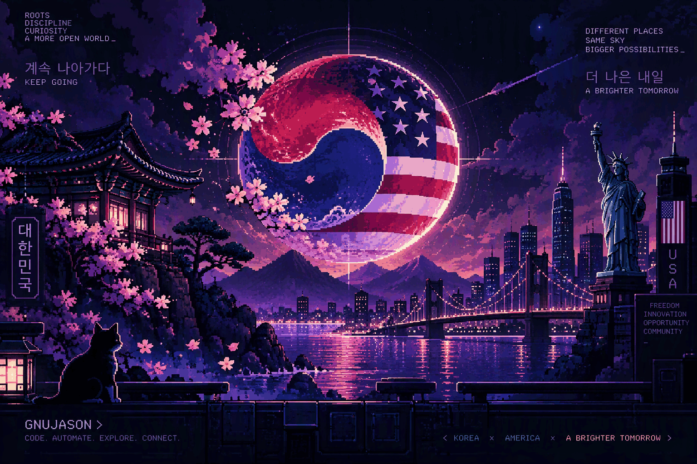
</picture>

<picture>
  <source media="(prefers-reduced-motion: reduce)" srcset="assets/banners/bunker-engineer.png">
  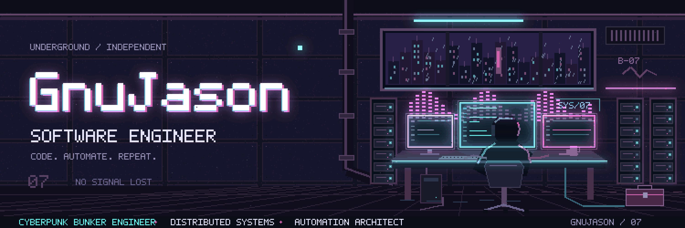
</picture>

<h1 align="center">GNUjason</h1>

<p align="center">
  <picture>
    <source media="(prefers-reduced-motion: reduce)" srcset="assets/animations/korean-character-still.png">
    
  </picture>
</p>

<p align="center">
  <b>Distributed Systems • Automation Architect</b>
</p>

<div align="center">
  <picture>
    <source media="(prefers-reduced-motion: reduce)" srcset="assets/animations/bunker-typing.png">
    
  </picture>
  <p>
    <a href="#operator-log">Operator Log</a> &nbsp; / &nbsp;
    <a href="#project-bays">Project Bays</a> &nbsp; / &nbsp;
    <a href="#toolchain">Toolchain</a> &nbsp; / &nbsp;
    <a href="https://github.com/GnuJason?tab=repositories">All Repositories</a>
  </p>
</div>

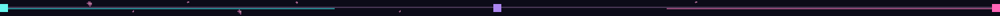

<a id="operator-log"></a>
Hi I'm Jason — My focus is software engineering and web development, but specifically the kind that turns raw systems into living, observable platforms — full‑stack applications, backend automation pipelines, real‑time data flows, and the infrastructure that keeps them running. I build the tools, the APIs, the telemetry, and the interfaces that make complex systems usable, visual, and alive.

```text
operator  : GnuJason
sector    : software engineering
focus     : software / web development
workbench : API‑driven content systems / automation scripts / data refresh pipelines / production‑ready web apps
```

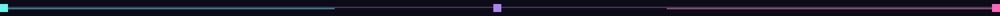

<p id="college-of-charleston" align="center">
  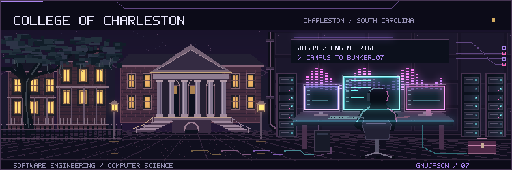
</p>

<p align="center">College of Charleston · Software Engineering / Computer Science · Charleston, South Carolina</p>

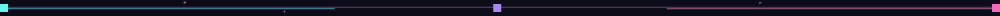

<p id="project-bays" align="center">
  <a href="https://github.com/GnuJason/F1"><picture><source media="(min-width: 1280px)" srcset="assets/guardians/framed-f1.png" width="420">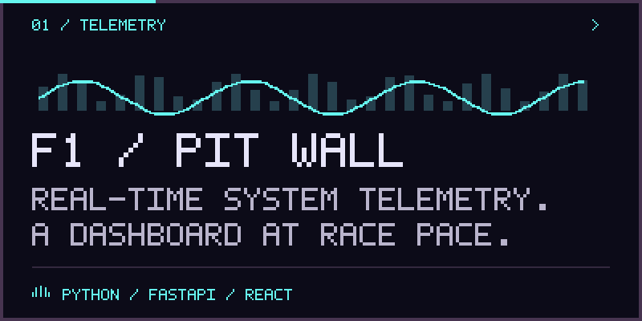</picture></a>
  <a href="https://github.com/GnuJason/geome"><picture><source media="(min-width: 1280px)" srcset="assets/guardians/framed-geome.png" width="420">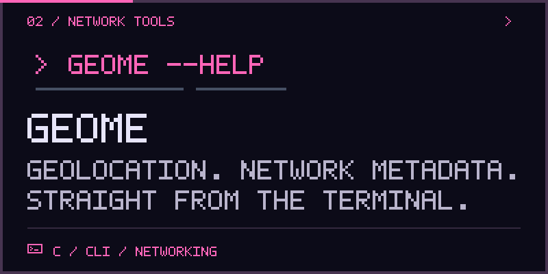</picture></a>
  <a href="https://github.com/GnuJason/Pulse-of-Humanity"><picture><source media="(min-width: 1280px)" srcset="assets/guardians/framed-pulse.png" width="420">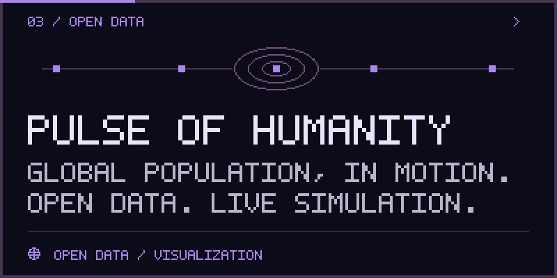</picture></a>
  <a href="https://github.com/GnuJason/spratforge"><picture><source media="(min-width: 1280px)" srcset="assets/guardians/framed-spratforge.png" width="420">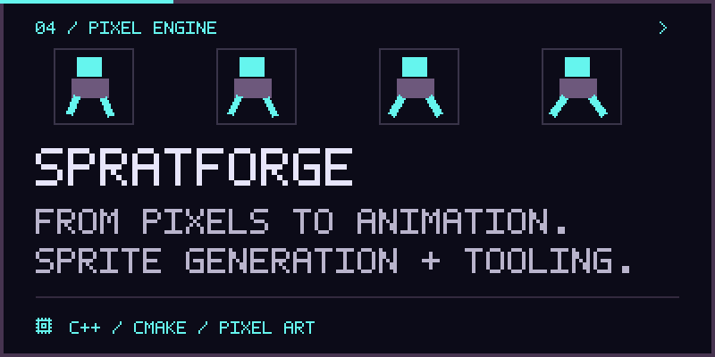</picture></a>
</p>

<p align="center">
  <a href="https://pulseofhumanity.org">Pulse of Humanity / Live</a> &nbsp; • &nbsp;
  <a href="https://www.pulseofkorea.org/">Pulse of Korea / Live</a> &nbsp; • &nbsp;
  <a href="https://github.com/GnuJason?tab=repositories">Explore the Workbench →</a>
</p>


<p id="toolchain" align="center">
  
  
  
  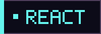
  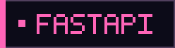
  
  
  
</p>


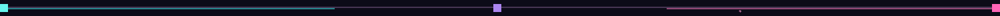

<a id="open-channel"></a>

<p align="center">
  <a href="https://github.com/GnuJason">GitHub / GnuJason</a> &nbsp; • &nbsp;
  <a href="https://github.com/GnuJason?tab=overview#js-contribution-activity">Contribution Log</a> &nbsp; • &nbsp;
  <a href="https://github.com/GnuJason/GnuJason/issues">Start a Conversation</a>
</p>

<div align="left">
  <a href="https://www.opensuse.org">
    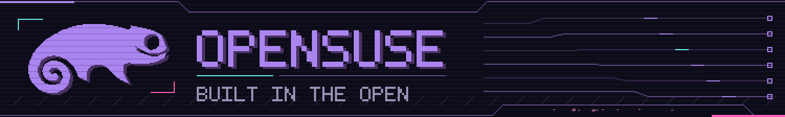
  </a>
</div>

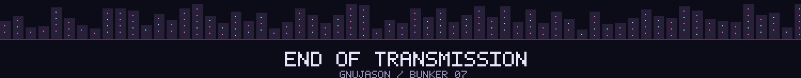
